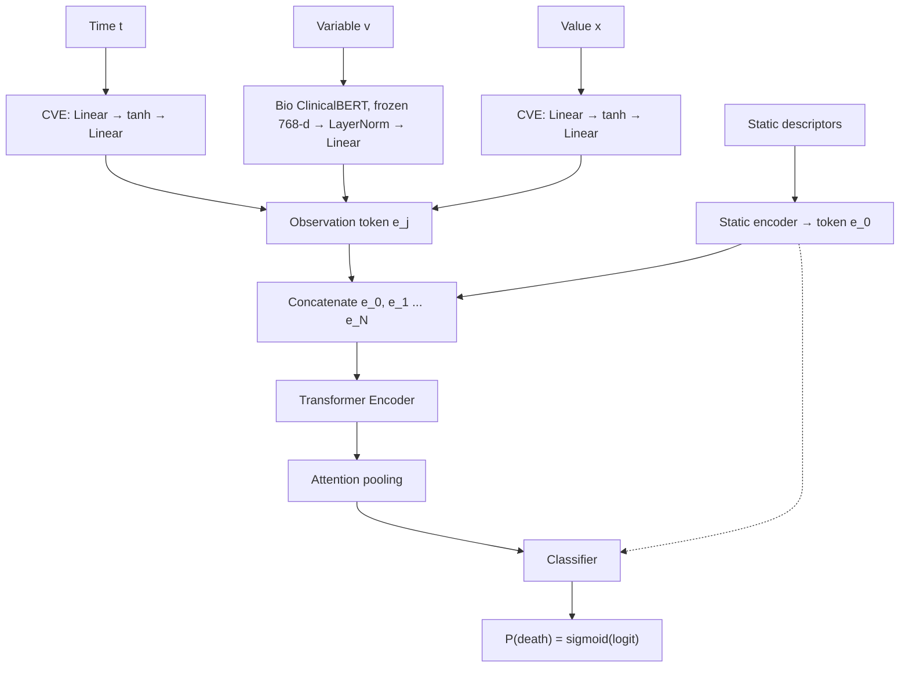

# Imput_Transformers

Transformer-based in-hospital mortality prediction for the [PhysioNet/Computing in Cardiology Challenge 2012](https://physionet.org/content/challenge-2012/).

## Overview

Intensive care unit (ICU) records are multivariate time series that are sparse, irregularly sampled and heavily affected by missing values: each physiological variable is measured at its own rate, and many are never recorded for a given patient. Developed for the PhysioNet/CinC Challenge 2012, this project studies Transformer architectures that handle this missingness by modelling the irregular series directly, one token per observation, and applies them to the challenge task: predicting in-hospital mortality from the first 48 hours of ICU stay.

## Dataset

The work uses the [PhysioNet/CinC Challenge 2012](https://physionet.org/content/challenge-2012/) dataset, which contains the first 48 hours of ICU stay for adult patients.

| Subset | Patients | Use                     |
|--------|----------|-------------------------|
| Set A  | 4000     | Training and validation |
| Set B  | 4000     | Test                    |

Each record includes:

- **Static descriptors:** `RecordID`, `Age`, `Gender`, `Height`, `ICUType`, `Weight`.
- **Time series:** 36 physiological variables (e.g. `HR`, `MAP`, `Temp`, `GCS`, `Lactate`, `Creatinine`, `FiO2`, `MechVent`), each with its own measurement timestamps.

### Prediction target

A binary target is derived from the outcome files (`Outcomes-a.txt`):

```
target = 1  if  2 <= Survival <= Length_of_stay
target = 0  otherwise
```

## Model architecture

`MortalityTransformer` (`src/modelo_mortalidad.py`) represents each patient as a set of observation triplets (time `t`, variable `v`, value `x`), in the spirit of STraTS. Each observation becomes one token. Variable embeddings come from a frozen Bio_ClinicalBERT encoding of each variable's description, and a trainable linear layer compresses them to `d_model`. Static descriptors are encoded as an extra token `e_0` that is prepended to the sequence.



Default hyperparameters (`src/config.py`): `d_model=128`, `n_heads=4`, `n_layers=4`, `d_ff=256`, `dropout=0.1`, `max_len=880`. The model is trained with `BCEWithLogitsLoss`, using a positive class weight to compensate for class imbalance.

## Project structure

```
Imput_Transformers/
├── data/
│   ├── raw/                              # Original PhysioNet files (not versioned)
│   └── processed/
│       ├── physionet2012.csv             # Long-format table built from the raw records
│       └── physionet2012_transformed.csv # Cleaned and transformed table used for modelling
├── models/
│   └── checkpoints/
│       └── d128_h4_l4.pt                 # Trained model (d_model=128, 4 heads, 4 layers)
├── notebooks/
│   ├── data_loading.ipynb                # Parsing of raw records and target construction
│   ├── data_transformation.ipynb         # Exploratory analysis, cleaning and transformations
│   ├── pipeline_datos.ipynb              # End-to-end data pipeline
│   └── figures/                          # Figures exported from the notebooks (PDF)
├── src/
│   ├── config.py                         # Base hyperparameters and experiment configurations
│   ├── dataloader_physionet.py           # PhysioNetDataset, padding/collate and data loaders
│   ├── modelo_mortalidad.py              # MortalityTransformer and its components
│   ├── train.py                          # Training loop, early stopping and metrics
│   └── run_mlflow.py                     # Runs every configuration and logs it to MLflow
├── requirements.txt
└── README.md
```

## Installation

Python 3.12 is recommended.

```bash
python -m venv .venv
source .venv/bin/activate
pip install -r requirements.txt
```

## Usage

1. Download the Challenge 2012 data from PhysioNet and place Set A and Set B under `data/raw/`.
2. Build the processed dataset by running the notebooks in order: `data_loading.ipynb`, `data_transformation.ipynb`, `pipeline_datos.ipynb`.
3. Train the model from the project root:

   ```bash
   python src/train.py        # single run with the default configuration
   python src/run_mlflow.py   # all configurations in src/config.py, tracked in MLflow
   mlflow ui                  # inspect the runs
   ```

Checkpoints are written to `models/checkpoints/`.

## Evaluation

Following the challenge task, the model is evaluated on in-hospital mortality prediction with ROC-AUC and average precision (AUPRC), together with precision-recall curves and threshold-based metrics.

## References

- Silva, I., Moody, G., Scott, D. J., Celi, L. A., and Mark, R. G. (2012). Predicting in-hospital mortality of ICU patients: The PhysioNet/Computing in Cardiology Challenge 2012. *Computing in Cardiology*, 39, 245-248.
- Vaswani, A. et al. (2017). Attention is all you need. *Advances in Neural Information Processing Systems*, 30.
